# Panduan Pengguna SiDistrib

**Admin, Dispatcher, dan Sopir**  
Edisi 10 November 2026 · Bahasa Indonesia

Panduan ini membantu pengguna menjalankan pekerjaan harian di SiDistrib. Nama menu dan tombol mengikuti tampilan aplikasi pada edisi ini. Gambar diambil dari lingkungan contoh dengan data awal; angka, nama pangkalan, dan jumlah penugasan di tempat kerja Anda dapat berbeda. Gambar rute aktif Sopir diberi label **contoh ilustratif** karena lingkungan contoh belum memiliki pengiriman yang diberangkatkan. Pengaturan hak akses perusahaan dapat membuat sebagian tombol tidak muncul pada akun tertentu.

## 1. Mulai menggunakan aplikasi

### Masuk, memilih perusahaan, dan keluar

1. Buka alamat SiDistrib yang diberikan kantor.
2. Masukkan nama pengguna dan kata sandi Anda, lalu pilih **Masuk**.
3. Periksa nama perusahaan atau unit aktif di bagian atas layar sebelum mencatat atau menyetujui pekerjaan. Jika Anda diberi akses ke beberapa unit, pilih unit yang akan dikerjakan dari pemilih tersebut.
4. Gunakan **Keluar** pada menu kiri setelah selesai, terutama pada perangkat bersama.

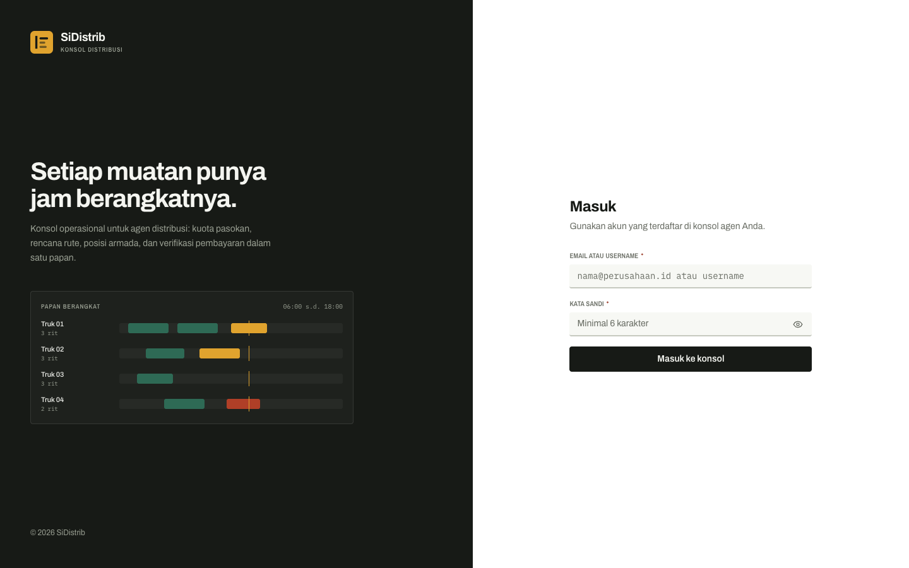

**Gambar 1.** Halaman masuk. Jangan membagikan kata sandi atau memakai akun rekan kerja.

### Mengenali halaman

Menu di kiri mengelompokkan pekerjaan harian, keuangan, data induk, dan notifikasi. Nama halaman terlihat di bagian atas. Gunakan pencarian, pilihan tanggal, atau filter status bila daftar sudah panjang. Angka di halaman beranda adalah ringkasan; buka daftar terkait untuk memeriksa rincian sebelum mengambil keputusan.

Status yang sering dijumpai: **Draf** berarti pekerjaan masih disiapkan; **Menunggu persetujuan/verifikasi** berarti perlu tindakan petugas berwenang; **Berjalan/Proses** berarti pengiriman sedang dilaksanakan; **Selesai/Disetujui** berarti tahap tersebut sudah dicatat; **Tertunda/Ditolak** berarti ada kendala atau perlu perbaikan. Bacalah catatan pada barisnya karena arti tindakan berikutnya bergantung pada jenis pekerjaan.

## 2. Panduan Admin

Admin mengawasi alur operasi, keuangan, data induk, dan akses pengguna. Untuk pekerjaan dengan pemisahan persetujuan, keputusan akhir tetap dilakukan oleh akun yang berwenang menurut aturan perusahaan.

### 2.1 Pemeriksaan awal hari

1. Buka **Beranda**. Periksa papan berangkat, pengiriman berjalan, pengiriman tertunda, sisa kuota, dan pembayaran yang menunggu verifikasi.
2. Tinjau **Notifikasi**, lalu buka pekerjaan yang memerlukan tindakan.
3. Cocokkan rencana pengiriman hari ini dengan SA aktif, kesiapan armada dan sopir, serta dana yang sudah diverifikasi.
4. Periksa transaksi kemarin yang belum lengkap sebelum menutup periode atau menyusun laporan.

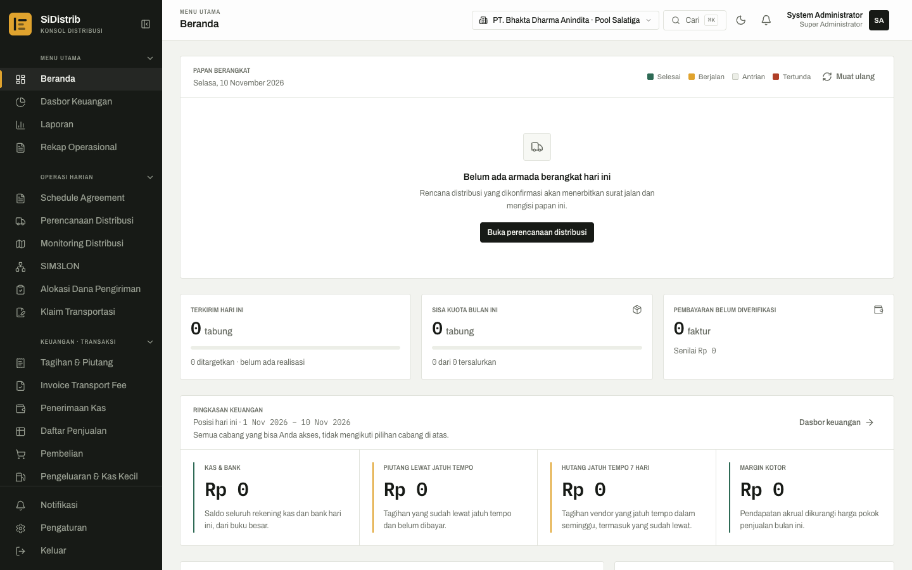

**Gambar 2.** Beranda Admin memberi gambaran pekerjaan hari ini.

### 2.2 Schedule Agreement dan kuota

**Schedule Agreement (SA)** adalah dasar kuota pengiriman untuk periode tertentu. Buka **Schedule Agreement** untuk melihat daftar SA, kuota cabang, sumber kuota, dan alur pemakaiannya. Bila perusahaan memakai SIM3LON, periksa data Penyaluran yang ditarik sebelum membuat rencana. Gunakan **Impor SIM3LON** saat data sumber sudah tersedia. **Catat manual** dipakai untuk mencatat dokumen SA yang diterima langsung dari mitra sesuai proses kantor.

Saat mencatat SA manual, isi nomor, penerbit, periode, total kuota, dan lampiran dokumen. SA masuk sebagai draf. Periksa dokumen dan aktifkan SA sesuai kewenangan sebelum kuotanya dipakai untuk rencana distribusi. Jangan membuat SA baru untuk menggandakan kuota yang sudah tercatat dari sumber yang sama.

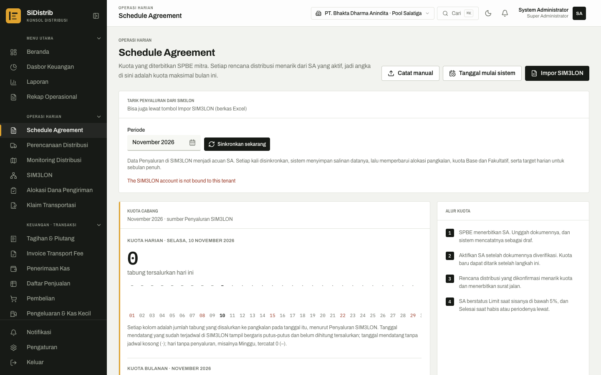

**Gambar 3.** Halaman SA menunjukkan sumber dan sisa kuota periode aktif.

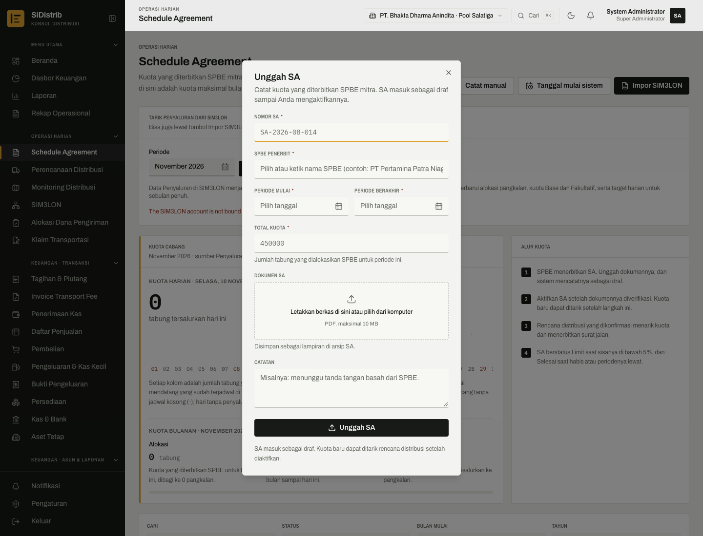

**Gambar 4.** Contoh formulir pencatatan SA manual.

### 2.3 Merencanakan dan memantau distribusi

Di **Perencanaan Distribusi**, pilih tanggal dan SA aktif, kemudian buat rencana harian. Tambahkan pangkalan yang akan dilayani, jumlah per produk, armada, dan sopir. Periksa kapasitas kendaraan, urutan singgah, serta kecukupan kuota sebelum mengonfirmasi. Penyimpanan titik singgah memakai kuota SA yang tersedia; setelah rencana dikonfirmasi dan rit diberangkatkan, surat jalan menjadi dasar kerja Sopir.

Jika data Penyaluran SIM3LON berubah, tinjau hasil pencocokan pada rencana terkait. Selesaikan perbedaan dan susun ulang penugasan yang terdampak sebelum konfirmasi. Perubahan pada sumber tidak boleh dianggap otomatis aman untuk rute yang sudah ditetapkan.

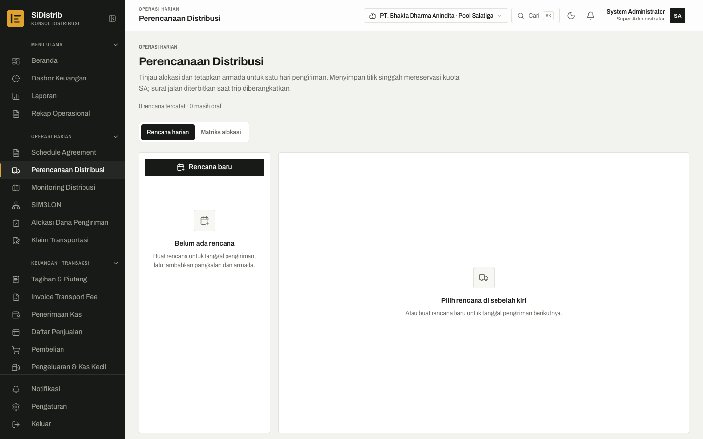

**Gambar 5.** Rencana harian dan matriks alokasi tersedia pada halaman yang sama.

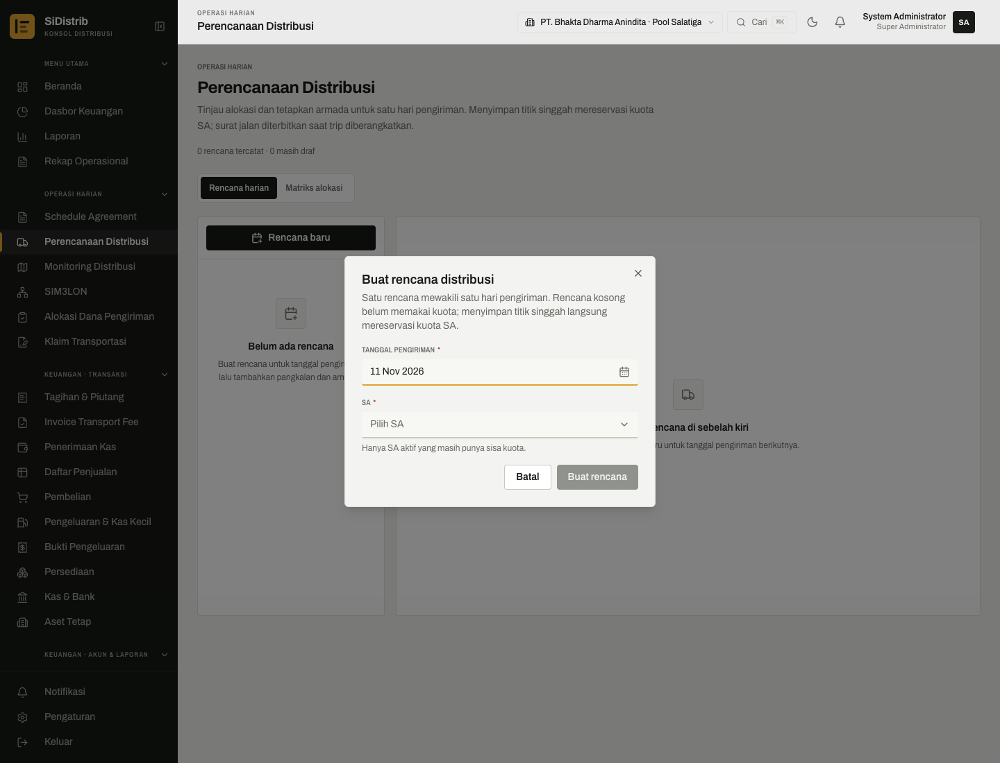

**Gambar 6.** Pilih tanggal dan SA aktif saat membuka rencana baru.

Di **Monitoring Distribusi**, pilih rentang tanggal untuk melihat realisasi, surat jalan berjalan, selesai, atau tertunda. Peta membantu memeriksa lokasi yang tersedia. Buka surat jalan untuk melihat rincian per pangkalan dan tindak lanjut kendala. Jika Sopir menandai pengiriman tertunda, koordinasikan jadwal ulang; jangan menghitungnya sebagai barang yang sudah diterima pangkalan.

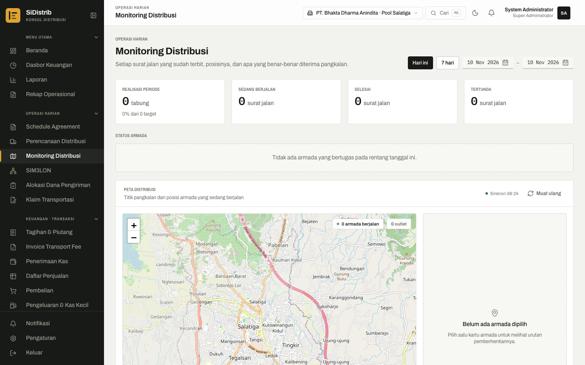

**Gambar 7.** Ringkasan realisasi dan status armada pada Monitoring Distribusi.

### 2.4 Data SIM3LON dan kesiapan dana

Halaman **SIM3LON** menampilkan data yang ditarik dari sumber luar. Bandingkan periode, alokasi, dan data Penyaluran dengan pekerjaan yang akan dijalankan. Ketika sambungan belum tersedia, layar dapat menunggu atau menampilkan pesan kegagalan. Minta penanggung jawab integrasi kantor memeriksanya; jangan menebak angka kuota dari layar yang belum selesai memuat.

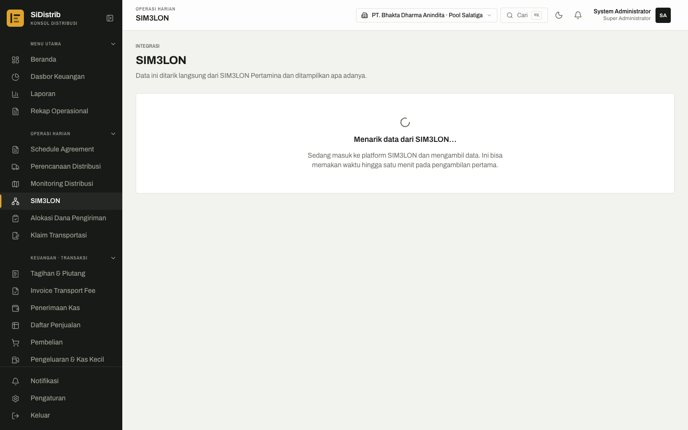

**Gambar 8.** Proses penarikan data SIM3LON. Waktu tampil bergantung pada layanan sumber.

Di **Alokasi Dana Pengiriman**, pastikan dana yang diperlukan untuk rencana telah diverifikasi dan dialokasikan sebelum rit diberangkatkan. Buka rincian untuk melihat kebutuhan dan kekurangannya. Jika dana belum cukup atau belum diverifikasi, selesaikan bersama petugas keuangan sebelum melanjutkan pengiriman.

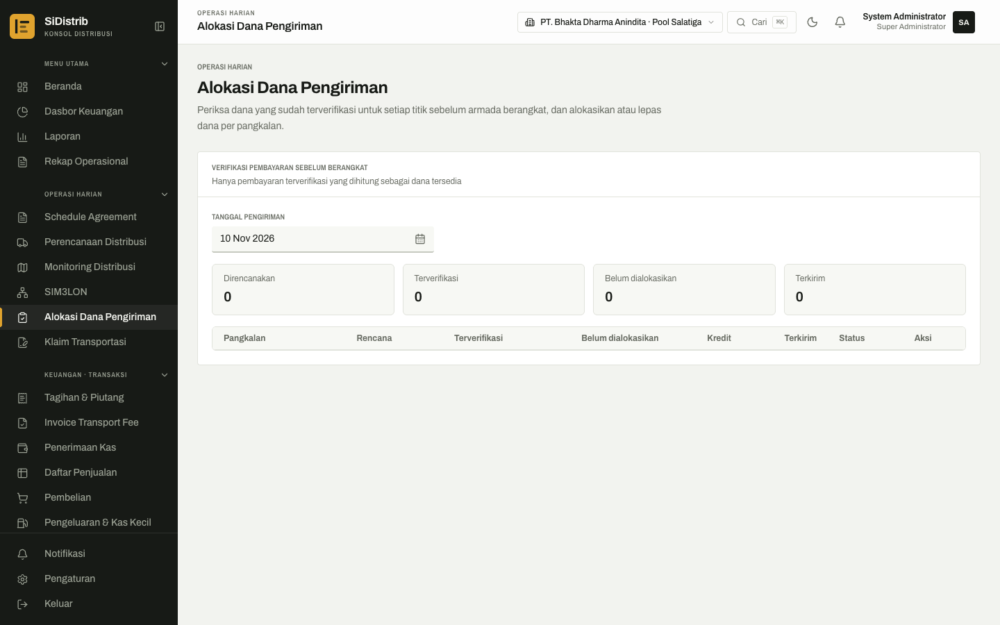

**Gambar 9.** Kesiapan dana sebelum keberangkatan.

### 2.5 Klaim dan invoice transportasi

Gunakan **Klaim Transportasi (BAST)** untuk membuat klaim per periode, mengisi baris dari LO SIM3LON atau pengiriman yang sudah selesai, dan meninjau nilai klaim. Periksa jumlah tabung serta berkas pendukung sebelum menyerahkan klaim. Pantau status hingga disetujui, ditolak, atau lunas; perbaiki klaim yang ditolak berdasarkan alasan yang diberikan.

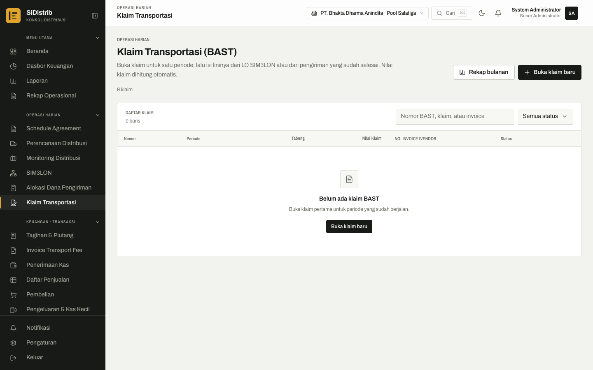

**Gambar 10.** Daftar klaim dan status BAST.

Setelah BAST disetujui, buka **Invoice Transport Fee** untuk membuat invoice sesuai nilai BA LO. Lengkapi dokumen yang diminta pada halaman, termasuk e-Faktur, NPWP, SKT, dan PKBP bila berlaku. Periksa nomor serta tanggal invoice sebelum menerbitkannya. Pencatatan status pada layanan luar tetap mengikuti proses kantor; jangan menganggap pengiriman ke layanan luar sudah terjadi hanya karena invoice tampak di SiDistrib.

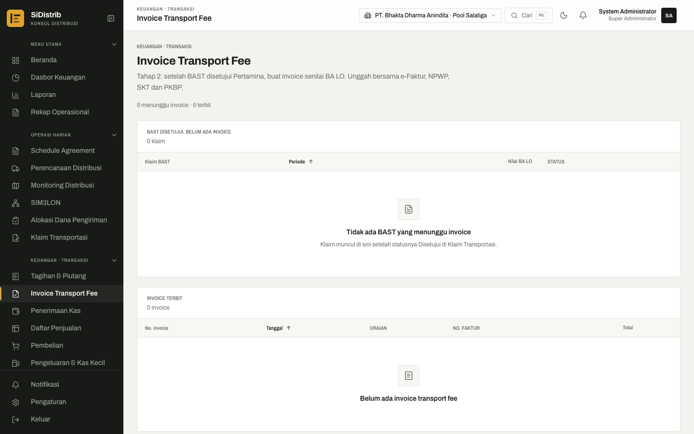

**Gambar 11.** BAST yang menunggu invoice dan daftar invoice terbit.

### 2.6 Tagihan, penerimaan, dan penjualan

**Tagihan & Piutang** menampilkan invoice pangkalan, umur tagihan, dan catatan kredit. Periksa tagihan yang lewat jatuh tempo sebelum menyetujui pengiriman berikutnya ke pangkalan yang sama. Tindak lanjut kredit dan penangguhan harus mengikuti keputusan petugas berwenang.

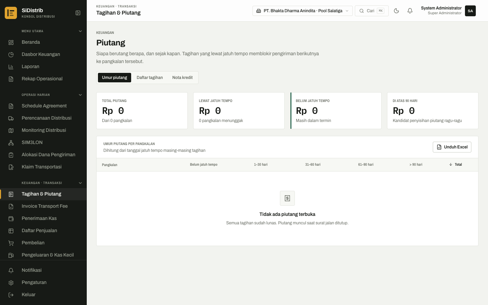

**Gambar 12.** Pantau tagihan terbuka dan umur piutang.

Pada **Penerimaan Kas**, catat pembayaran yang masuk, periksa bukti transfer, lalu verifikasi atau tolak sesuai hasil pemeriksaan. Alokasikan penerimaan yang sudah terverifikasi ke invoice yang benar; satu transfer dapat dipakai untuk beberapa invoice. Jika ada kelebihan pembayaran atau permintaan pengembalian, ajukan melalui proses persetujuan yang tersedia.

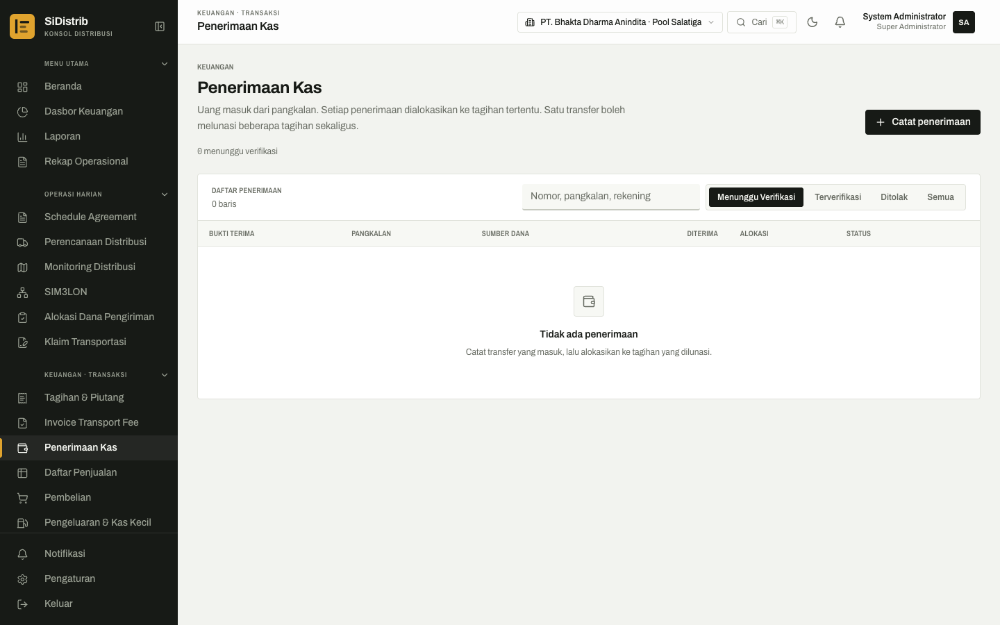

**Gambar 13.** Daftar penerimaan dan pekerjaan verifikasi.

**Daftar Penjualan** membantu mencari transaksi berdasarkan tanggal, status, atau pangkalan, lalu mengunduh rekap saat diperlukan. Gunakan rincian transaksi untuk menelusuri asal tagihan, bukan mengubah angka laporan secara terpisah.

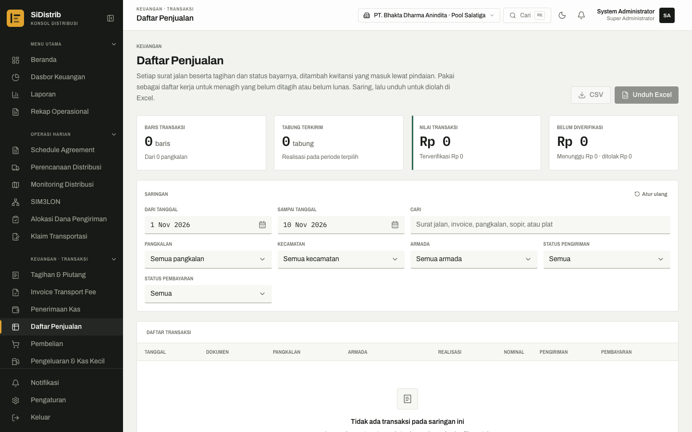

**Gambar 14.** Daftar transaksi penjualan.

### 2.7 Pembelian, pengeluaran, dan bukti biaya

Di **Pembelian**, catat tagihan pemasok dan pembayaran bertahap sesuai dokumen pendukung. Cocokkan pemasok, jumlah, jatuh tempo, dan referensi SA sebelum menyimpan. Pantau kewajiban yang belum dibayar di daftar yang sama.

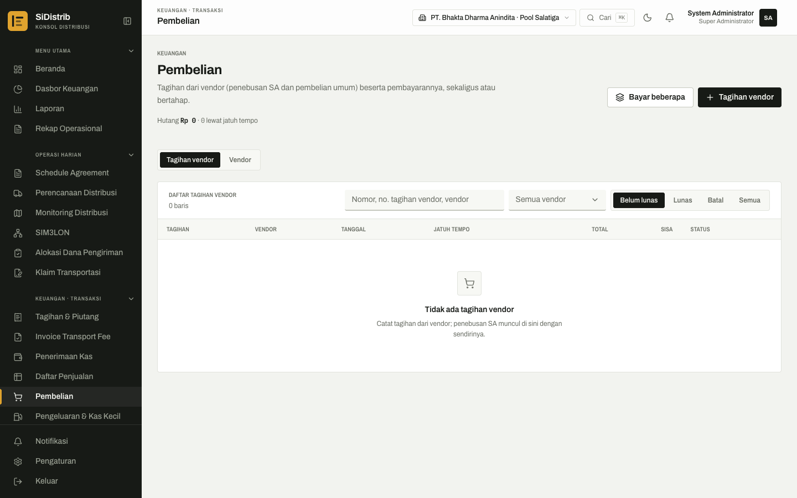

**Gambar 15.** Daftar pembelian dan tagihan pemasok.

Di **Pengeluaran & Kas Kecil**, pilih **Catat pengeluaran**, isi kategori, penerima pembayaran, jumlah, tanggal, dan bukti. Ajukan untuk persetujuan. Pengeluaran yang belum benar dapat diperbaiki atau ditarik sesuai statusnya. Nilai tertentu dapat memerlukan persetujuan kedua, sehingga pembuat catatan tidak boleh menganggap biaya langsung final.

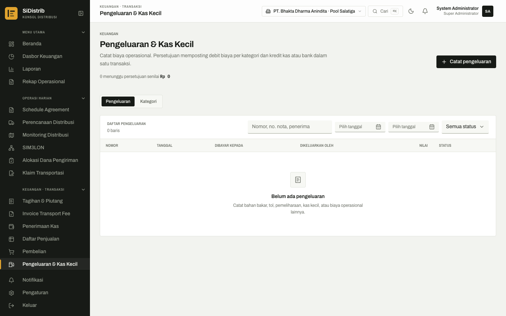

**Gambar 16.** Pengeluaran yang menunggu persetujuan.

**Bukti Pengeluaran** menampung foto struk atau PDF nota dari kantor maupun Sopir. Pilih **Unggah bukti**, kemudian periksa hasil pembacaan, nilai, tanggal, dan kategori. Arsipkan bukti yang benar atau tandai untuk pemeriksaan ulang. Setelah diperiksa, catat sebagai pengeluaran bila memang merupakan biaya perusahaan.

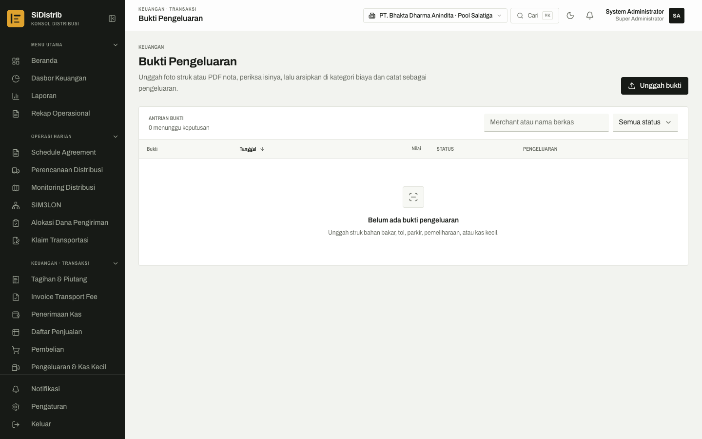

**Gambar 17.** Antrean bukti yang perlu diperiksa.

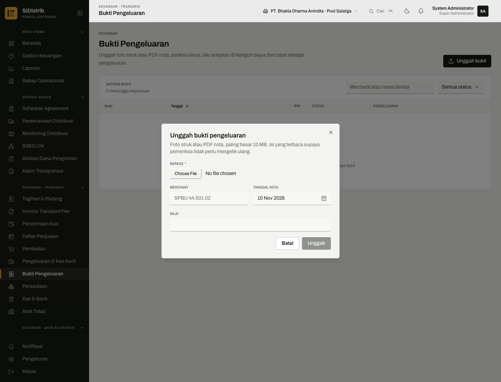

**Gambar 18.** Unggah foto atau PDF yang jelas dan utuh.

### 2.8 Persediaan, kas, aset, dan persetujuan

**Persediaan** menunjukkan saldo tiap produk dan riwayat pergerakannya. Gunakan stok awal satu kali saat memulai pencatatan, lalu lakukan pemeriksaan fisik dan penyesuaian melalui proses stok opname. Selisih harus ditelusuri sebelum angka dipakai untuk perencanaan.

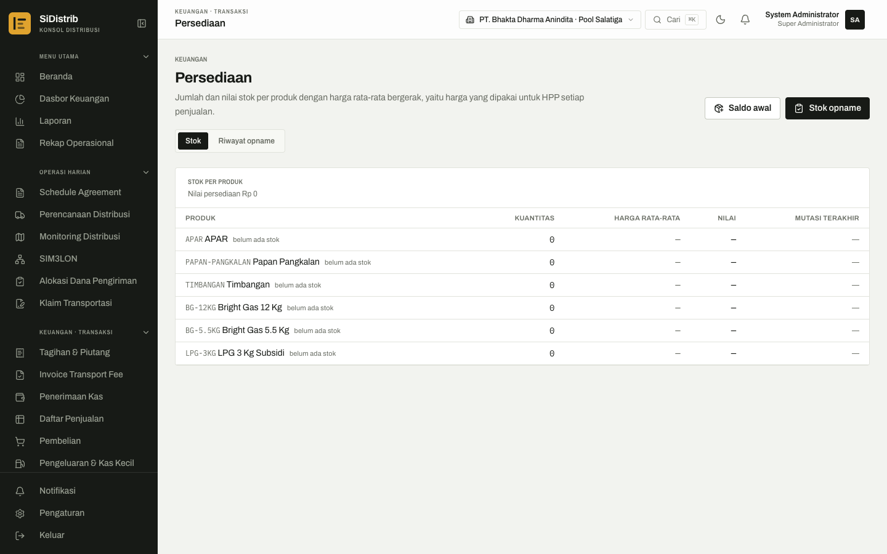

**Gambar 19.** Stok per produk dan akses ke riwayat persediaan.

**Kas & Bank** dipakai untuk memeriksa rekening, mencatat kas masuk, kas keluar, transfer, mengimpor mutasi bank, dan melakukan rekonsiliasi. Cocokkan setiap baris mutasi dengan dokumen dan transaksi yang sesuai; jangan menandai selisih sebagai selesai tanpa penjelasan.

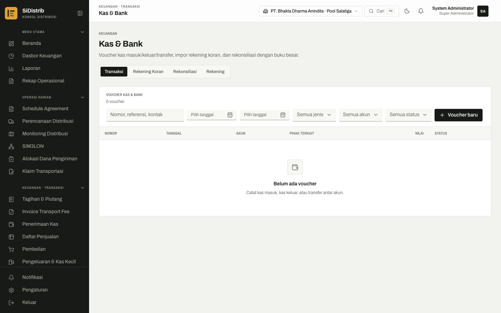

**Gambar 20.** Ringkasan kas, bank, dan rekonsiliasi.

Di **Aset Tetap**, catat aset perusahaan, identitas, tanggal perolehan, dan nilai sesuai dokumen. Gunakan daftar ini untuk memantau penyusutan dan kecocokan dengan laporan keuangan.

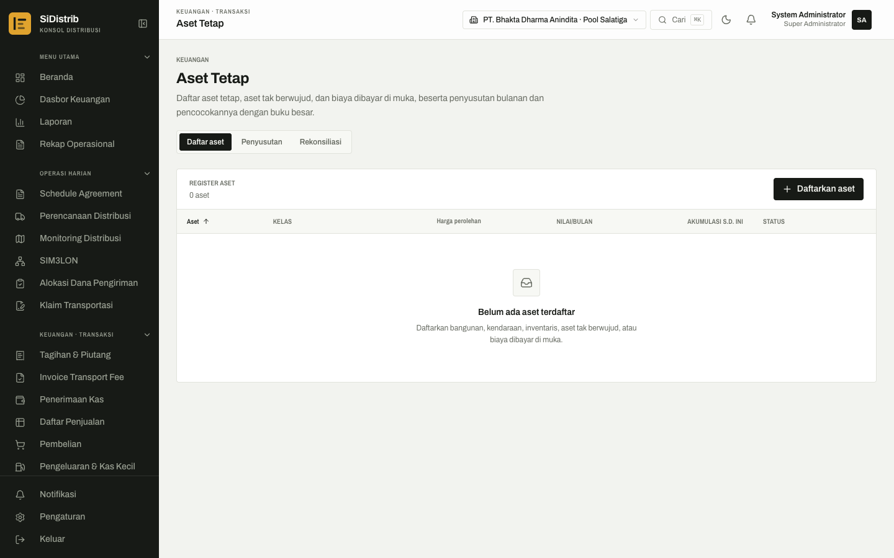

**Gambar 21.** Daftar aset tetap.

**Persetujuan** menampilkan permintaan seperti pembatalan dan pengembalian dana yang memerlukan peninjauan. Baca alasan, transaksi asal, dan bukti sebelum memilih setuju atau tolak. Persetujuan dapat membentuk catatan keuangan, sehingga koreksi sesudahnya memerlukan proses yang tepat.

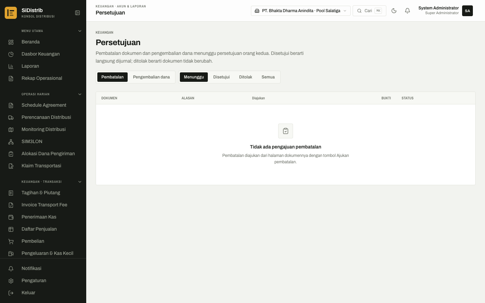

**Gambar 22.** Antrean persetujuan yang memerlukan keputusan.

### 2.9 Akun, jurnal, saldo awal, dan tutup buku

**Daftar Akun** adalah daftar kategori pembukuan yang digunakan perusahaan. Gunakan pencarian untuk menemukan akun sebelum memilih kategori transaksi atau memeriksa laporan.

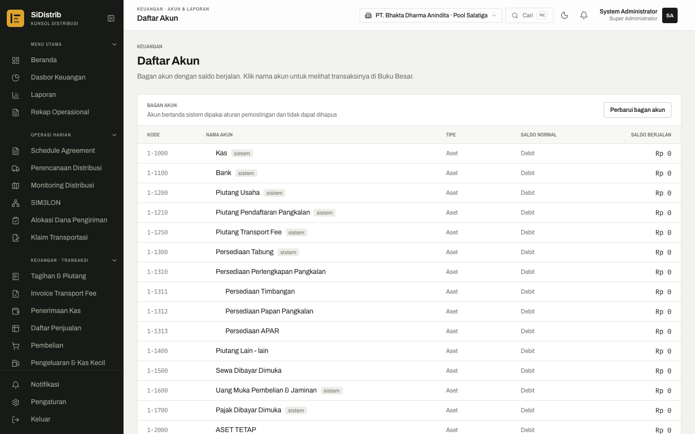

**Gambar 23.** Daftar akun pembukuan.

**Jurnal Umum** menampilkan catatan transaksi keuangan. Periksa tanggal, akun, dan nilai debit-kredit. Bila diperlukan koreksi atas jurnal yang sudah tercatat, gunakan tindakan pembalik yang disediakan, lalu catat transaksi pengganti sesuai kewenangan.

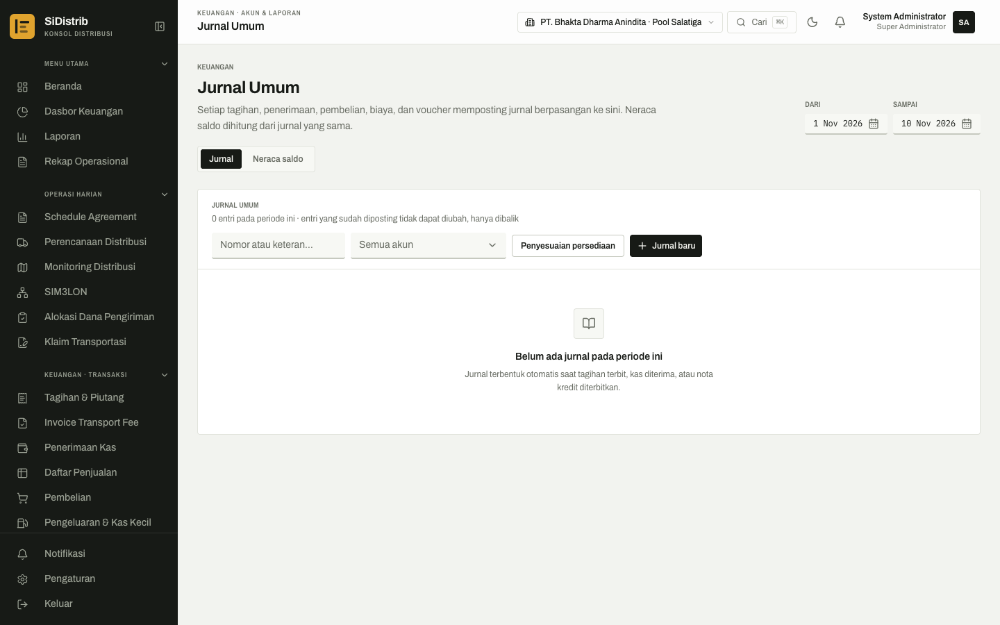

**Gambar 24.** Daftar jurnal dan pencarian transaksi.

**Saldo Awal** dipakai saat perusahaan mulai menggunakan SiDistrib. Unduh templat, isi neraca saldo, piutang, utang, dan aset sesuai arsip yang sudah disetujui, lalu unggah dan tinjau pratinjau sebelum menerapkan. Proses ini bersifat awal; mintalah pemeriksaan ulang bila angka tidak cocok.

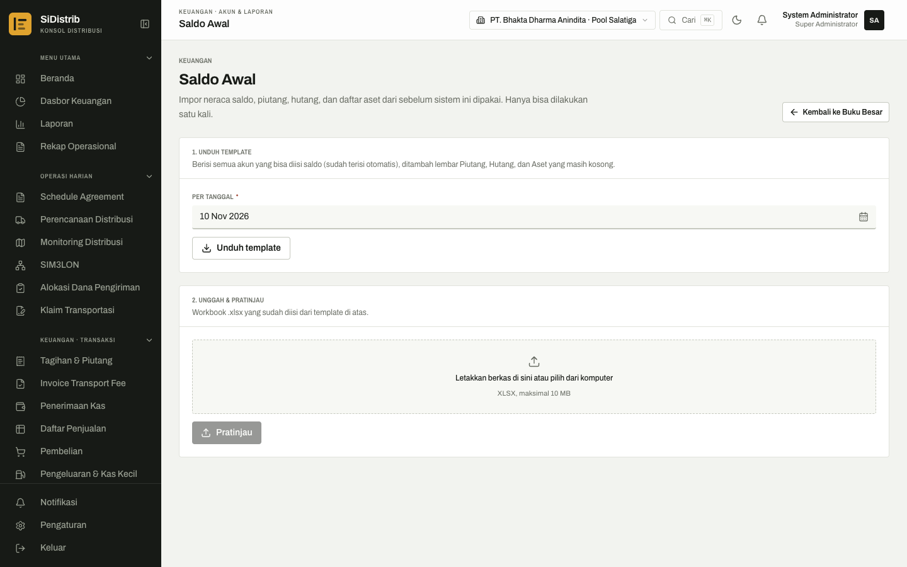

**Gambar 25.** Tahapan pemuatan saldo awal.

Di **Tutup Buku**, periksa bulan yang masih terbuka, transaksi yang belum diselesaikan, dan laporan sebelum menutup periode. Penutupan tahun dilakukan setelah seluruh bulan terkait benar dan disetujui. Koordinasikan pembukaan ulang atau koreksi dengan penanggung jawab keuangan.

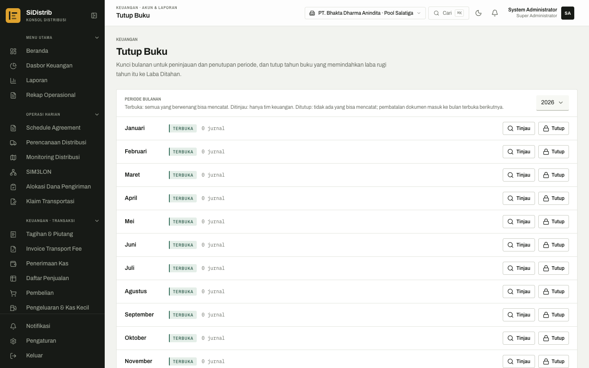

**Gambar 26.** Daftar periode dan status penutupan.

### 2.10 Laporan dan evaluasi

**Laporan Keuangan** memuat laba rugi, neraca, dan rincian akun. Pilih periode serta perbandingan yang diperlukan, kemudian periksa angka sebelum mencetak atau mengunduh. **Dasbor Keuangan** merangkum kas/bank, piutang, utang, laba, dan tren. **Laporan** menyediakan berbagai rekap transaksi; **Rekap Operasional** menyoroti pelaksanaan distribusi.

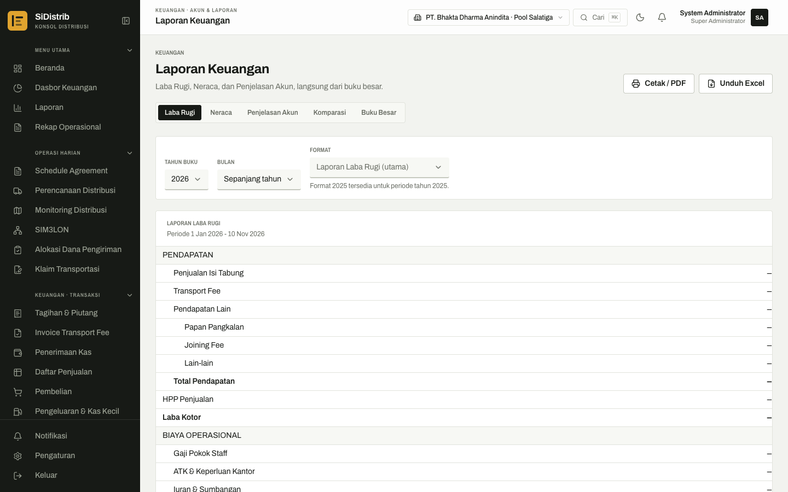

**Gambar 27.** Pilih laporan dan periode keuangan.

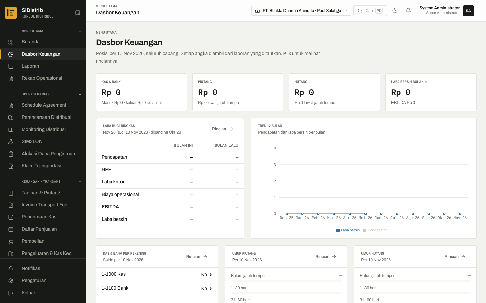

**Gambar 28.** Ringkasan posisi keuangan.

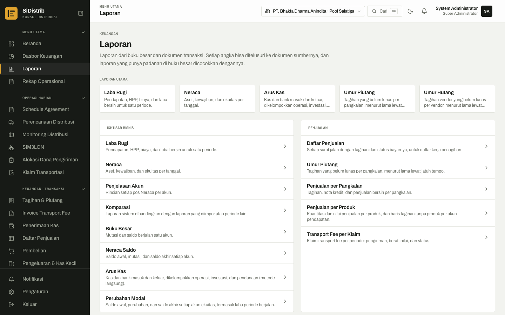

**Gambar 29.** Pilihan laporan transaksi dan umur tagihan.

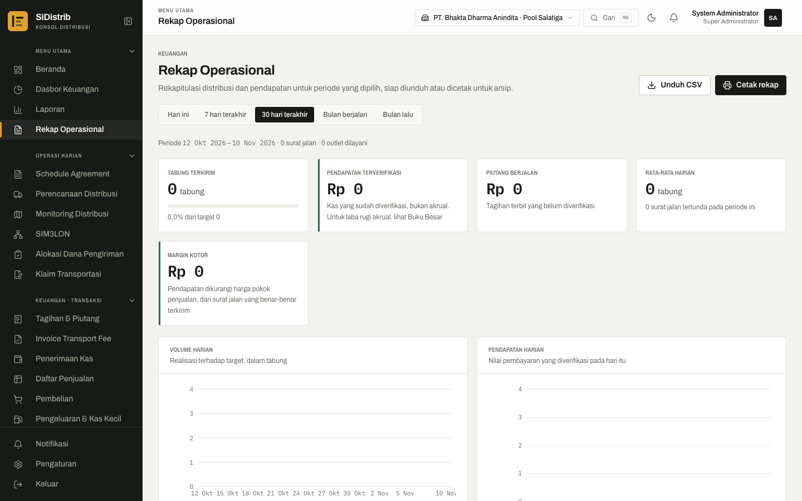

**Gambar 30.** Rekap pekerjaan distribusi menurut periode.

### 2.11 Menjaga data induk dan akses

**Outlet** menyimpan pangkalan, wilayah, kuota, status, dan tagihan. Periksa identitas serta status pangkalan sebelum menempatkannya pada rencana. Pangkalan yang ditangguhkan atau melewati aturan kredit perlu diselesaikan dulu dengan petugas terkait.

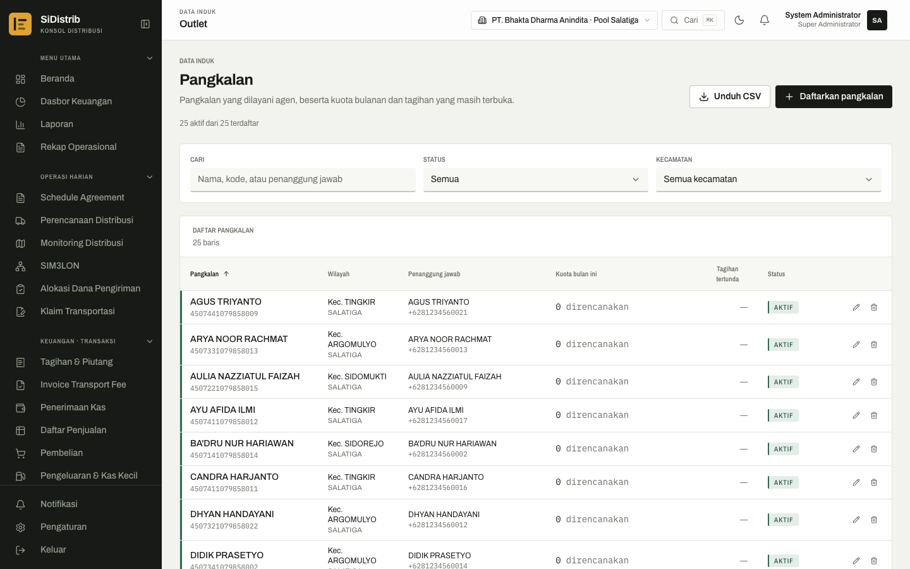

**Gambar 31.** Daftar pangkalan dan statusnya.

**Sopir** dan **Armada** dipakai untuk memeriksa ketersediaan petugas, kapasitas kendaraan, serta masa berlaku dokumen seperti STNK/KIR. Pastikan data benar sebelum penugasan per rit.

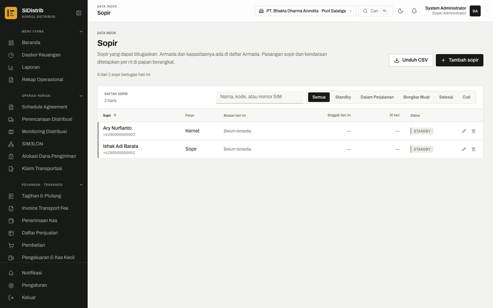

**Gambar 32.** Daftar sopir dan status kerja.

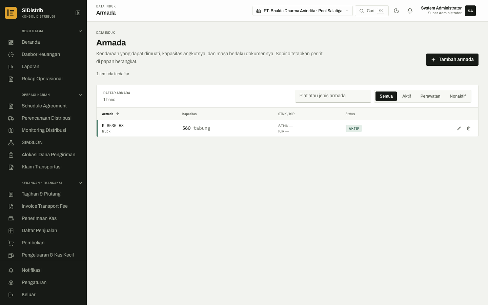

**Gambar 33.** Daftar kendaraan, kapasitas, dan dokumen.

**Pagar Geografis** membantu menandai lokasi pangkalan untuk pemeriksaan kunjungan. Perbaiki titik yang keliru melalui petugas yang berwenang. Sinyal lokasi telepon dapat berubah, jadi gunakan catatan Sopir dan bukti serah terima saat menilai penyimpangan.

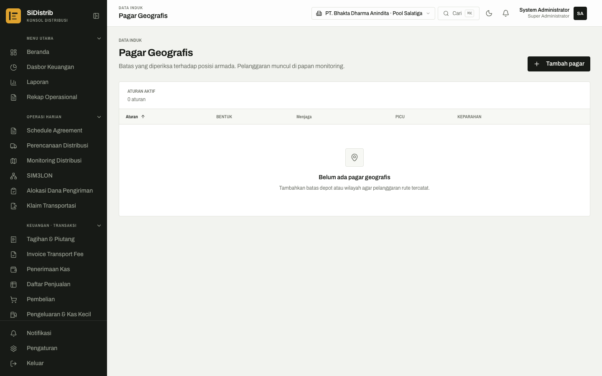

**Gambar 34.** Pengaturan lokasi pangkalan.

**Produk** menyimpan daftar barang yang didistribusikan. Periksa nama, satuan, dan status produk sebelum dipakai pada SA, rencana, atau transaksi.

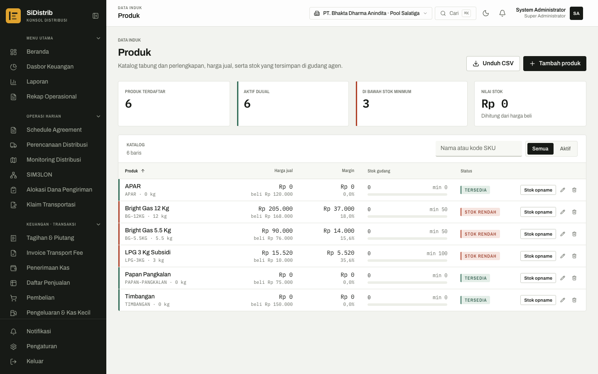

**Gambar 35.** Daftar produk perusahaan.

**Tenant** menampilkan susunan perusahaan dan unit yang dapat dilihat akun Anda. Selalu periksa unit aktif di bagian atas sebelum membuat data. **Pengguna & Akses** dipakai untuk meninjau akun, peran, dan izin. Berikan akses sesuai tugas nyata pengguna dan nonaktifkan akun yang tidak lagi dipakai sesuai proses kantor.

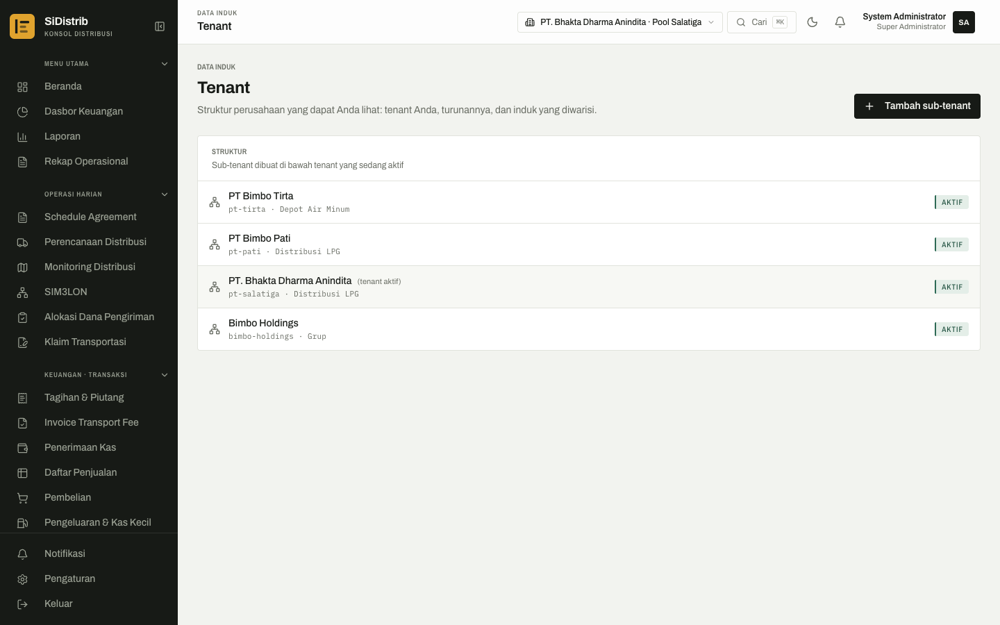

**Gambar 36.** Struktur perusahaan dan penanda unit aktif.

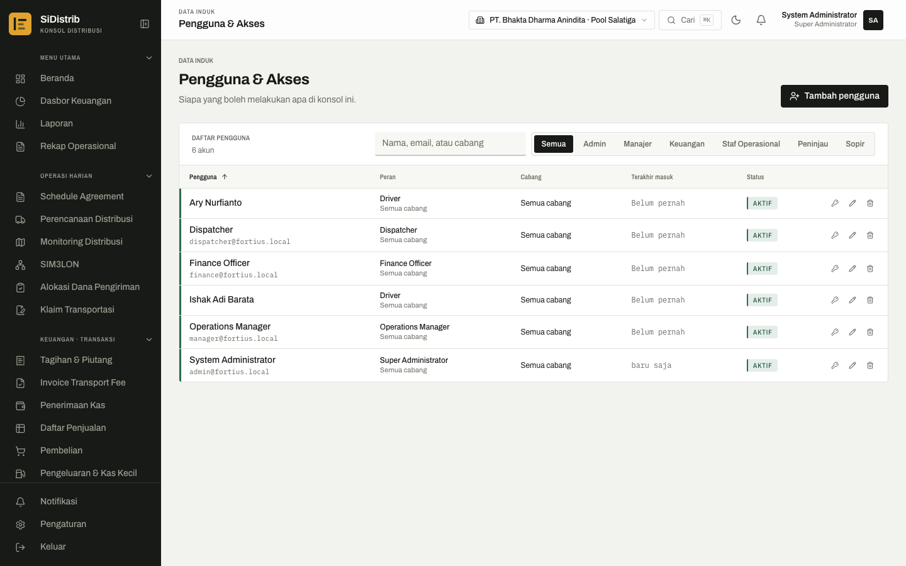

**Gambar 37.** Daftar pengguna dan perannya.

### 2.12 Notifikasi dan pengaturan

**Notifikasi** menampilkan peringatan, pengingat, dan kabar sistem. Tandai dibaca setelah pekerjaan terkait ditangani. **Pengaturan** memuat profil, identitas perusahaan, pilihan operasi, istilah, data referensi, serta pilihan sistem. Perubahan pengaturan dapat memengaruhi pekerjaan banyak pengguna; lakukan sesuai kebijakan perusahaan.

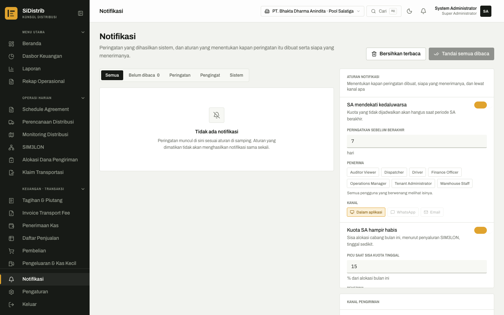

**Gambar 38.** Pusat notifikasi Admin.

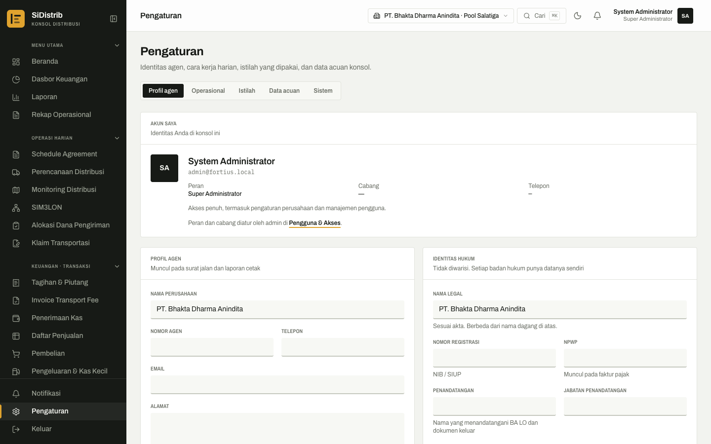

**Gambar 39.** Kelompok pengaturan perusahaan.

## 3. Panduan Dispatcher

Dispatcher menyiapkan dan mengawasi pengiriman. Menu yang tersedia pada akun contoh meliputi Beranda, SA, Perencanaan, Monitoring, Klaim Transportasi, Invoice Transport Fee, Pengeluaran, Bukti Pengeluaran, Outlet, Sopir, Armada, Tenant, dan Notifikasi. Ketersediaan tindakan di tiap menu mengikuti izin akun.

### 3.1 Sebelum armada berangkat

1. Buka **Beranda** dan periksa papan berangkat, antrean, serta pengiriman tertunda.
2. Periksa **Schedule Agreement** yang aktif dan sisa kuota. Bila data SIM3LON belum termuat atau akses kuota ditolak, hubungi Admin; jangan memakai angka lama sebagai dasar keputusan.
3. Buka **Perencanaan Distribusi**. Pilih tanggal, SA, pangkalan, jumlah, armada, dan sopir. Periksa kapasitas dan urutan kunjungan sebelum meminta konfirmasi.
4. Minta Admin atau petugas keuangan menyelesaikan verifikasi serta alokasi dana bila rencana belum siap diberangkatkan.
5. Pastikan Sopir menerima rute setelah surat jalan terbit.

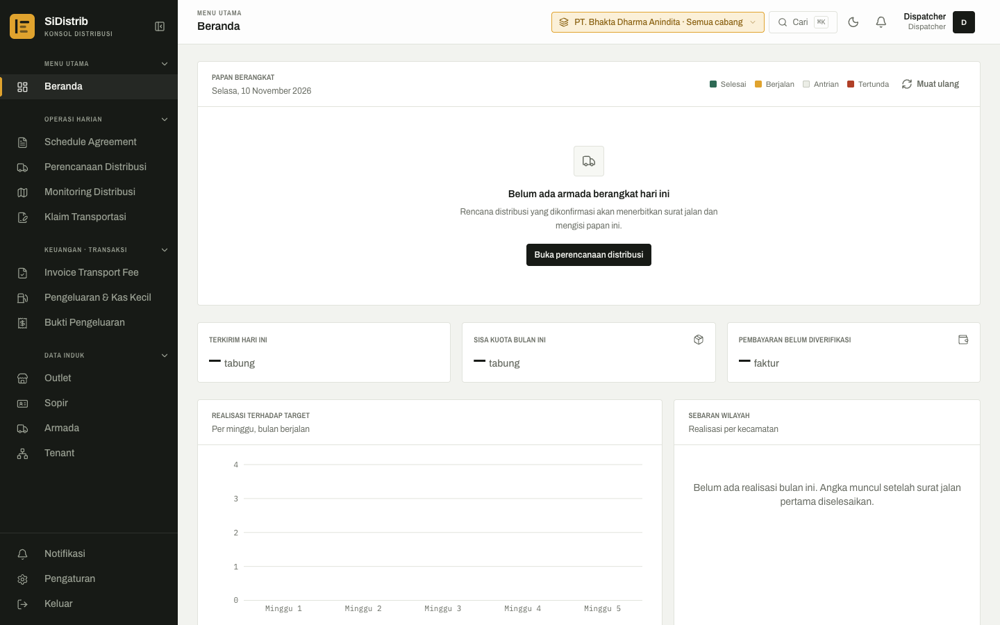

**Gambar 40.** Papan berangkat yang dipakai Dispatcher.

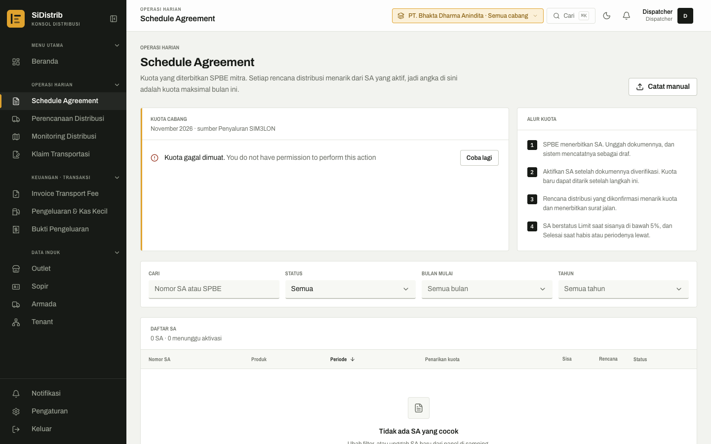

**Gambar 41.** Halaman SA. Contoh lingkungan ini menampilkan pesan akses pada kartu kuota; minta Admin bila hal serupa terjadi pada akun Anda.

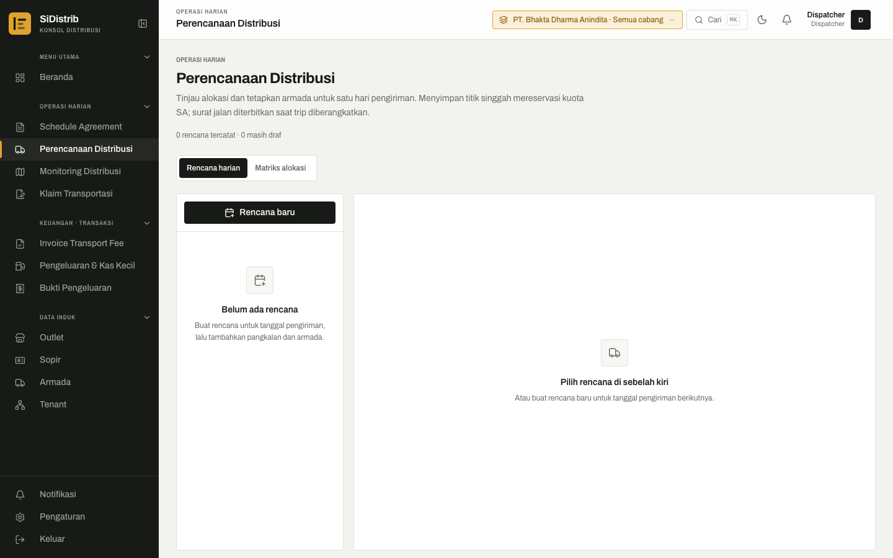

**Gambar 42.** Tempat Dispatcher menyusun rencana harian.

### 3.2 Saat perjalanan berlangsung

Gunakan **Monitoring Distribusi** untuk memantau surat jalan berjalan, jumlah terkirim, dan rute tertunda. Hubungi Sopir bila ada perbedaan jumlah atau keterlambatan. Untuk laporan kendala, periksa alasan dan bukti, lalu koordinasikan jadwal ulang. Jangan mengubah pengiriman yang sudah diterima pangkalan menjadi tertunda tanpa proses koreksi yang sesuai.

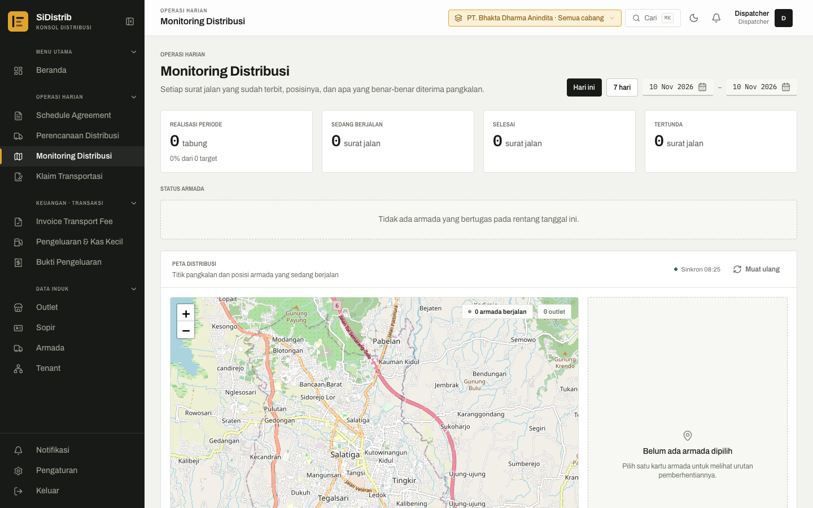

**Gambar 43.** Pantau status armada dan realisasi selama hari berjalan.

### 3.3 Setelah pengiriman

Di **Klaim Transportasi (BAST)**, kumpulkan pengiriman selesai atau LO yang sesuai periode, periksa jumlah dan dokumen, lalu serahkan klaim untuk ditinjau. Setelah BAST disetujui, gunakan **Invoice Transport Fee** untuk menyiapkan invoice serta lampiran yang diminta kantor. Pantau status kedua daftar sampai pekerjaan selesai.

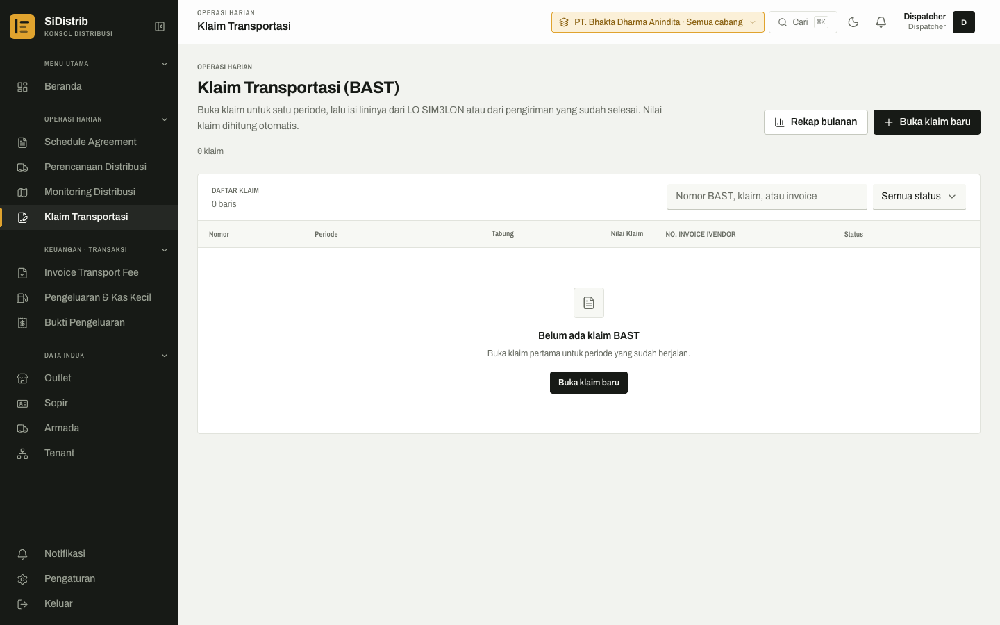

**Gambar 44.** Daftar klaim transportasi Dispatcher.

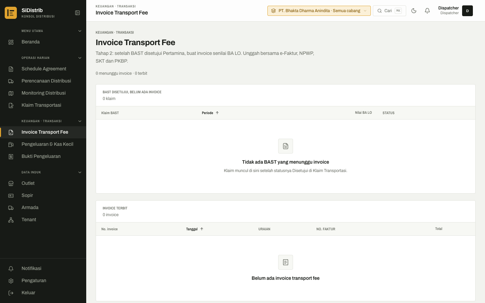

**Gambar 45.** Daftar BAST yang siap dibuatkan invoice.

Biaya perjalanan dapat dicatat melalui **Pengeluaran & Kas Kecil** atau diawali dari **Bukti Pengeluaran**. Pastikan struk jelas, tanggal dan nilai benar, serta kategori sesuai. Pengajuan belum sama dengan persetujuan; pantau status hingga diperiksa petugas berwenang.

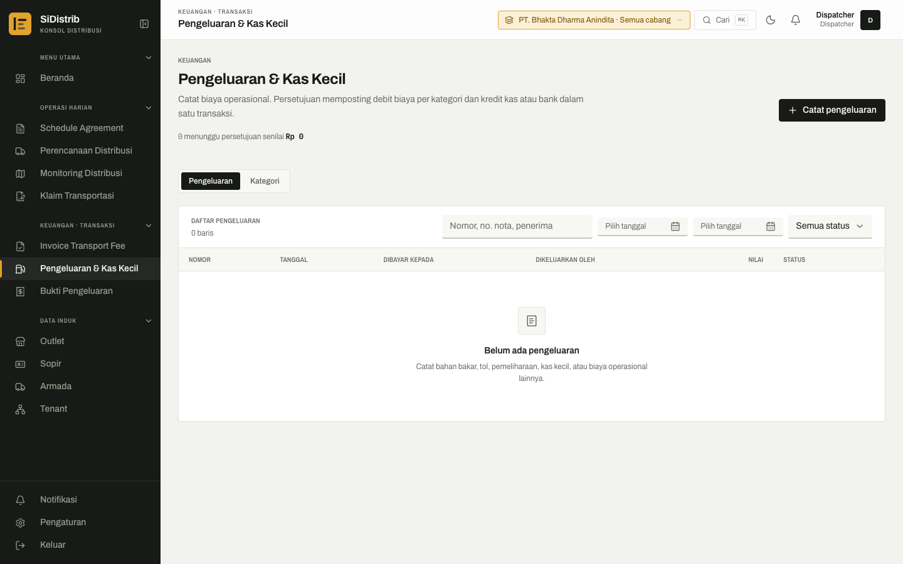

**Gambar 46.** Pengeluaran yang dicatat kantor operasional.

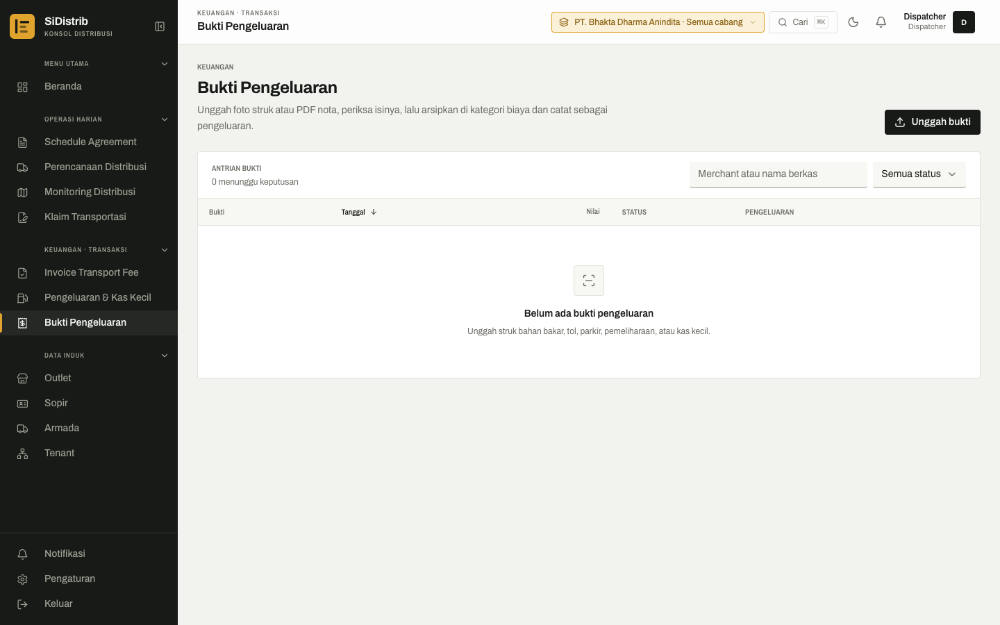

**Gambar 47.** Antrean bukti biaya perjalanan.

### 3.4 Menjaga kesiapan data operasional

Periksa **Outlet** sebelum memasukkan pangkalan ke rute, terutama status aktif dan tagihan tertunda. Pada **Sopir**, periksa siapa yang tersedia; pada **Armada**, periksa kapasitas dan dokumen kendaraan. **Tenant** membantu memastikan unit yang sedang aktif. Gunakan **Notifikasi** untuk melihat pekerjaan yang perlu ditangani.

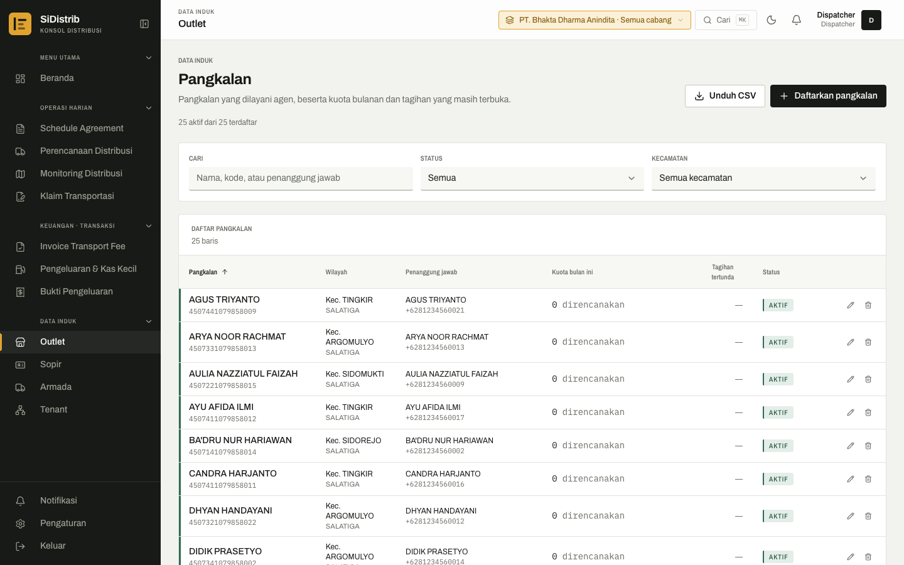

**Gambar 48.** Data pangkalan untuk perencanaan.

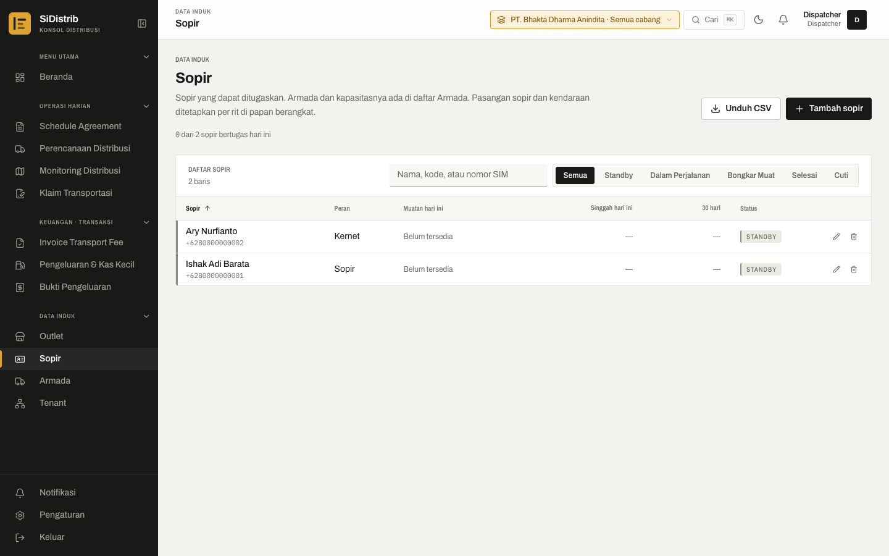

**Gambar 49.** Ketersediaan sopir dan kernet.

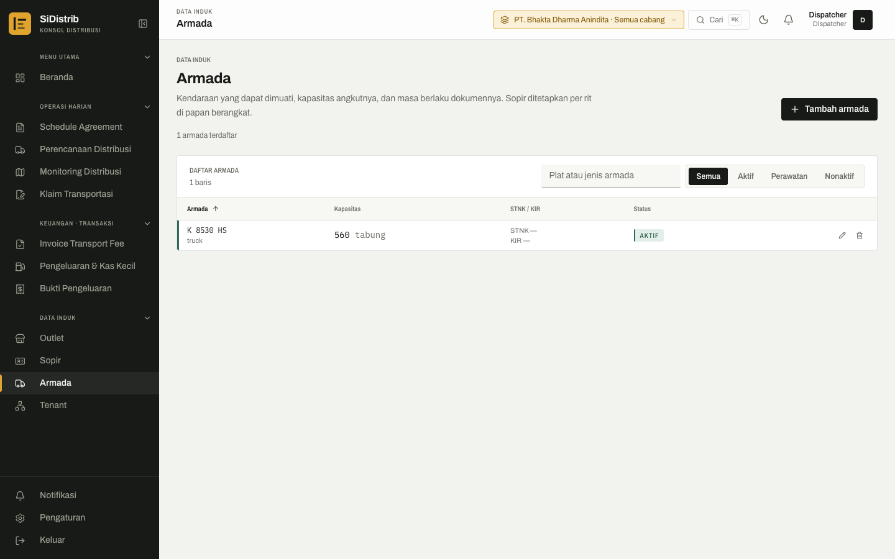

**Gambar 50.** Kapasitas dan status armada.

**Gambar 51.** Pastikan unit aktif benar sebelum mencatat pekerjaan.

**Gambar 52.** Peringatan dan pengingat Dispatcher.

## 4. Panduan Sopir

Sopir menggunakan **Rute Saya** untuk mencatat perjalanan dan penerimaan di setiap pangkalan. Gunakan ponsel yang baterainya cukup dan periksa sinyal sebelum berangkat. Bila bertugas sebagai kernet, tampilan menjelaskan peran tersebut; pencatatan perjalanan tetap mengikuti penugasan kantor.

### 4.1 Menerima rute

1. Masuk dengan akun Anda dan buka **Rute Saya**.
2. Periksa nama, kendaraan, kernet, jumlah singgah, dan jumlah muatan.
3. Baca urutan pangkalan dan rincian barang pada setiap kartu. Gunakan **Telepon** atau **Navigasi** bila perlu.
4. Jika layar menampilkan **Tidak ada penugasan hari ini**, hubungi Dispatcher. Rute muncul setelah kantor mengonfirmasi rencana dan menerbitkan surat jalan.

**Gambar 53.** Tampilan saat belum ada rute yang diterbitkan.

**Gambar 54.** Contoh ilustratif rute aktif pada ponsel; nama pangkalan dan nomor surat jalan di gambar ini adalah data contoh.

### 4.2 Mencatat perjalanan dan serah terima

Untuk setiap pangkalan, tekan **Berangkat ke pangkalan ini** saat memulai perjalanan. Ketika tiba, tekan **Tiba di lokasi**. Setelah barang dihitung bersama penerima, tekan **Selesai: catat penerimaan**. Isi jumlah yang benar-benar diterima untuk setiap produk, jumlah kosong yang kembali bila ada, nama penerima, dan catatan bila jumlah berbeda dari surat jalan. Foto bukti dapat dilampirkan. Periksa sekali lagi sebelum memilih **Tutup surat jalan**, karena jumlah ini menjadi dasar tagihan.

**Gambar 55.** Contoh ilustratif pencatatan jumlah diterima, nama penerima, catatan, dan foto.

Jika pangkalan tutup, menolak barang, atau ada kendala lain, pilih **Ada kendala di lokasi**, tulis alasan yang jelas, lalu pilih **Tandai tertunda**. Beri tahu Dispatcher agar tindak lanjut atau jadwal ulang dapat disiapkan. Barang yang tertunda tidak dicatat sebagai sudah diterima.

**Gambar 56.** Contoh ilustratif formulir kendala di pangkalan.

### 4.3 Lokasi dan sinyal lemah

Pilihan **Rekam perjalanan** membagikan posisi selama rute saat diaktifkan. Saat menekan tombol pencatatan, aplikasi juga mencoba mengambil posisi pada saat itu. Jika ponsel tidak mendapat sinyal, catatan dapat tersimpan sementara di perangkat dan tampil sebagai **menunggu dikirim**. Biarkan akun tetap masuk, sambungkan internet, lalu gunakan **Kirim sekarang** bila diperlukan. Pastikan status terkirim sebelum pulang dan serahkan dokumen fisik sesuai prosedur kantor.

### 4.4 Bukti biaya dan notifikasi

Buka **Bukti Pengeluaran** untuk mengunggah struk bahan bakar, tol, parkir, atau biaya perjalanan lain sesuai kebijakan kantor. Foto seluruh struk dengan jelas, periksa tanggal dan nilai, lalu pantau status pemeriksaannya. Biaya belum dianggap disetujui hanya karena berkas berhasil diunggah. Buka **Notifikasi** untuk melihat pesan pekerjaan dan pengingat.

**Gambar 57.** Antrean struk yang dikirim Sopir.

**Gambar 58.** Pusat notifikasi Sopir.

## 5. Jika sesuatu tidak sesuai

- **Menu atau tombol tidak muncul:** periksa akun dan unit aktif. Hubungi Admin jika tugas Anda memerlukan akses tersebut.
- **SA atau data SIM3LON tidak termuat:** tunggu proses selesai, muat ulang satu kali, lalu laporkan kepada penanggung jawab integrasi bila masih gagal. Jangan meneruskan rencana memakai angka yang belum diverifikasi.
- **Rencana tidak bisa dikonfirmasi atau diberangkatkan:** periksa kuota SA, kesiapan armada/sopir, perubahan data sumber, dan verifikasi dana. Minta petugas terkait menuntaskan hambatan yang ditampilkan.
- **Rute Sopir kosong:** minta Dispatcher memeriksa penugasan dan surat jalan. Jangan mencatat pengiriman menggunakan akun orang lain.
- **Jumlah diterima berbeda:** catat jumlah sebenarnya, tulis alasan, dan lampirkan foto bila tersedia. Hubungi Dispatcher sebelum meninggalkan pangkalan jika selisih besar.
- **Catatan menunggu dikirim:** sambungkan internet, buka kembali Rute Saya, dan pastikan catatan berhasil terkirim sebelum keluar dari akun.
- **Bukti atau pengeluaran ditolak:** baca alasan, perbaiki berkas atau data yang diminta, lalu ajukan kembali sesuai status yang tersedia.

## 6. Ringkasan urutan kerja

**Admin:** tinjau SA dan data sumber → pastikan dana serta data induk siap → awasi rencana dan pengiriman → periksa tagihan, penerimaan, biaya, persetujuan → tinjau laporan dan tutup periode.

**Dispatcher:** periksa kuota dan kesiapan armada → susun rencana → pantau rute dan kendala → siapkan klaim serta berkas transportasi → tindak lanjuti biaya perjalanan.

**Sopir:** periksa rute → catat berangkat dan tiba → catat jumlah diterima atau kendala → pastikan catatan terkirim → unggah struk dan serahkan dokumen fisik.
